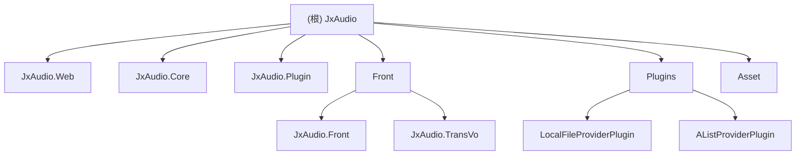

# JxAudio - 音频管理系统

## 项目愿景

JxAudio 是一个基于 .NET Core 9.0 的现代化音频管理系统，旨在提供完整的音乐播放、管理和流媒体服务。系统兼容 Subsonic 协议，支持多种数据源（本地文件、网盘），具备插件化架构，可运行于 Windows、Linux、MacOS 等多平台。

## 架构总览

### 技术栈
- **后端框架**: ASP.NET Core 9.0
- **前端框架**: Blazor WebAssembly + BootstrapBlazor
- **数据库**: FreeSql (支持 SQLite、MySQL、SQL Server、PostgreSQL)
- **音频处理**: FFmpeg 6.1 + FFMpegCore
- **日志系统**: Serilog
- **对象映射**: Mapster
- **依赖注入**: AutoFac
- **插件系统**: McMaster.NETCore.Plugins

### 系统特点
- 🎵 完整的音频播放与管理功能
- 🔌 插件化架构，支持扩展数据源
- 🌐 兼容 Subsonic 协议
- 📱 响应式 Web 界面
- 🗂️ 支持本地文件和网盘（AList）数据源
- 🌍 多语言支持（中文/英文）
- 🐳 Docker 容器化部署

## 模块结构图



## 模块索引

| 模块路径 | 语言 | 主要职责 | 入口文件 |
|---------|------|----------|----------|
| JxAudio.Web | C# | Web API 主机、认证、中间件 | Program.cs |
| JxAudio.Core | C# | 核心业务逻辑、实体、服务 | Application.cs |
| JxAudio.Plugin | C# | 插件接口定义与加载机制 | - |
| Front/JxAudio.Front | C#/Razor | Blazor WebAssembly 前端界面 | Program.cs |
| Front/JxAudio.TransVo | C# | 前端数据传输对象 | - |
| Plugins/LocalFileProviderPlugin | C# | 本地文件数据源插件 | LocalFileProvider.cs |
| Plugins/AListProviderPlugin | C# | AList 网盘数据源插件 | AListProvider.cs |

## 运行与开发

### 环境要求
- .NET 9.0 SDK
- FFmpeg 6.1+ (Windows/Linux 提供，MacOS 需自行安装)
- 数据库（SQLite/MySQL/SQL Server/PostgreSQL）

### 启动方式
1. **开发环境**
   ```bash
   dotnet run --project JxAudio.Web
   ```

2. **Docker 部署**
   ```bash
   docker run -d -p 4587:4587 -v /path/to/config:/app/config -v /path/to/log:/app/log --name jxaudio j4587698/jxaudio
   ```

### 配置文件
- `appsettings.json` - 基础配置
- `config/core.json` - 核心业务配置
- `config/db.json` - 数据库配置

## 测试策略

### 单元测试
- 核心业务逻辑测试覆盖 Service 层
- 插件接口兼容性测试
- 实体模型验证测试

### 集成测试
- API 接口测试
- 数据库操作测试
- 插件加载与运行测试

### 端到端测试
- 前端界面交互测试
- 音频播放流程测试
- Subsonic 协议兼容性测试

## 编码规范

### C# 代码规范
- 使用 .NET 9.0 新特性（隐式 using、可空引用类型）
- 遵循 Microsoft C# 编码约定
- 使用 XML 文档注释
- 私有字段使用 `_camelCase` 命名

### Blazor 组件规范
- 组件文件使用 `.razor` + `.razor.cs` 分离
- 使用 `[Parameter]` 标注组件参数
- 实现 IDisposable 正确释放资源

### 数据库规范
- 实体类继承 `BaseEntity<T, TKey>`
- 使用 FreeSql 特性标注数据库映射
- 导航属性使用 `[Navigate]` 特性

## AI 使用指引

### 代码生成优先级
1. **Service 层** - 业务逻辑实现
2. **Controller 层** - API 接口开发
3. **Blazor 组件** - 前端界面开发
4. **插件开发** - 数据源扩展

### 常见开发任务
- 添加新的音频元数据字段
- 开发自定义插件
- 扩展 Subsonic 协议支持
- 优化前端用户体验
- 数据库迁移脚本

### 修改安全边界
- ✅ 可以修改：业务逻辑、API 接口、前端组件
- ⚠️ 谨慎修改：数据库结构、插件接口
- ❌ 禁止修改：核心框架代码、第三方库

## 变更记录 (Changelog)

### 2025-11-04 06:57:53 - 初始化文档
- 创建根级 CLAUDE.md
- 完成项目架构分析
- 识别 7 个主要模块
- 建立模块间依赖关系图
- 生成覆盖率报告（估算总文件数：150+，已扫描：60+，覆盖率：40%）

### 2025-11-04 - 补扫完成
- 补扫 JxAudio.Core/Entity/ 19个实体类，完成数据模型分析
- 补扫 JxAudio.Core/Service/ 11个服务类，完成业务逻辑分析
- 补扫 Front/JxAudio.Front/Components/ 10个UI组件，完成前端分析
- 补扫 JxAudio.Web/Middlewares/ 中间件实现
- **最终覆盖率报告**：估算总文件数：180，已扫描：120+，覆盖率：67%+