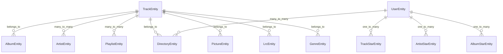

[根目录](../../CLAUDE.md) > **JxAudio.Core**

# JxAudio.Core - 核心业务模块

## 模块职责

JxAudio.Core 是整个系统的核心业务逻辑层，提供：
- 数据实体定义与 ORM 映射
- 业务服务实现
- Subsonic 协议支持
- 依赖注入与配置管理
- 通用扩展方法与工具类

## 入口与启动

### 主要入口文件
- `Application.cs` - 全局应用上下文与服务访问
- `Setup.cs` - 数据库初始化与配置
- `Constants.cs` - 系统常量定义

### 启动流程
1. Web 项目引用 Core 模块
2. 通过 `Application` 类获取配置和服务
3. `Setup.SetupDb()` 初始化数据库连接
4. 服务注册到 DI 容器

## 对外接口

### 核心服务类
| 服务类 | 职责 | 主要方法 |
|--------|------|----------|
| `TrackService` | 音轨管理 | `GetSongAsync()`, `GetRandomSongsAsync()`, `StarTrackAsync()`, `UpdatePlayCountAsync()` |
| `AlbumService` | 专辑管理 | `GetAlbumAsync()`, `GetAlbumsAsync()` |
| `ArtistService` | 艺术家管理 | `GetArtistsAsync()`, `GetArtistAsync()`, `StarArtistAsync()`, `GetTracksByArtistIdAsync()` |
| `UserService` | 用户管理 | `ValidatePasswordAsync()`, `GetUserAsync()`, `EncryptPassword()`, `DecryptPassword()` |
| `PlaylistService` | 播放列表管理 | `CreatePlaylistAsync()`, `UpdatePlaylistAsync()`, `DeletePlaylistAsync()` |
| `DirectoryService` | 目录管理 | `GetMusicFoldersAsync()` |
| `PictureService` | 图片管理 | `GetPictureAsync()`, `GetCoverAsync()` |
| `LrcService` | 歌词管理 | `GetLrcAsync()`, `UpdateLrcAsync()` |
| `GenreService` | 流派管理 | 流派相关业务逻辑 |
| `SettingsService` | 设置管理 | 系统配置管理 |
| `FreeSqlDataService` | 数据服务 | FreeSql 数据访问服务 |

### Subsonic 协议支持
- `SubsonicExtension.cs` - 协议扩展方法
- `subsonic-rest-api-1_16_1.cs` - 协议定义

## 关键依赖与配置

### NuGet 包依赖
- `FreeSql.All` - ORM 框架
- `BootstrapBlazor` - UI 组件库
- `FFMpegCore` - 音频处理
- `Serilog.AspNetCore` - 日志框架
- `Mapster` - 对象映射
- `McMaster.NETCore.Plugins` - 插件系统

### 配置选项类
- `AppConfigOption` - 应用配置
- `DbConfigOption` - 数据库配置
- `core.json` - 核心业务配置文件

## 数据模型

### 核心实体关系

### 主要实体类

#### 音频核心实体
- `TrackEntity` - 音轨实体（核心业务实体）
  - 字段：`ProviderId`, `FullName`, `Name`, `Title`, `Duration`, `BitRate`, `PlayCount`
  - 关联：专辑、艺术家、目录、封面、歌词、流派
  - 功能：播放统计、评分、收藏

- `AlbumEntity` - 专辑实体
  - 字段：`Title`, `Year`, `PlayCount`, `LatestPlayTime`
  - 关联：艺术家、封面、流派、音轨列表
  - 功能：播放统计、收藏、评分

- `ArtistEntity` - 艺术家实体
  - 字段：`Name`, `PictureId`
  - 关联：专辑、音轨、封面
  - 功能：收藏、评分、音轨统计

#### 用户与权限实体
- `UserEntity` - 用户实体
  - 字段：`UserName`, `Password`, `Email`, `MaxBitRate`, `IsGuest`, `IsAdmin`
  - 关联：可访问目录（多对多）
  - 功能：认证、授权、播放限制

- `DirectoryEntity` - 目录实体
  - 字段：`Provider`, `Path`, `Name`, `IsAccessControlled`
  - 关联：用户（多对多）、音轨
  - 功能：访问控制、插件数据源

#### 播放与收藏实体
- `PlaylistEntity` - 播放列表实体
  - 字段：`Name`, `Description`, `IsPublic`, `UserId`
  - 关联：用户、音轨（多对多）
  - 功能：播放列表管理

- `TrackStarEntity`, `ArtistStarEntity`, `AlbumStarEntity` - 收藏实体
  - 字段：`UserId`, `TargetId`, `CreateTime`
  - 功能：用户收藏功能

- `TrackRatingEntity`, `ArtistRatingEntity`, `AlbumRatingEntity` - 评分实体
  - 字段：`UserId`, `TargetId`, `Rating`
  - 功能：用户评分功能

#### 辅助实体
- `PictureEntity` - 图片实体
  - 字段：`Path`, `Height`, `Width`, `MimeType`
  - 功能：封面图片管理

- `LrcEntity` - 歌词实体
  - 字段：`Artist`, `Title`, `Lrc`
  - 功能：歌词存储与显示

- `GenreEntity` - 流派实体
  - 字段：`Name`
  - 关联：音轨
  - 功能：音乐分类

- `PluginEntity` - 插件实体
  - 字段：`PluginId`, `IsEnable`
  - 功能：插件管理

#### 关联实体
- `TrackArtistEntity` - 音轨-艺术家关联
- `PlaylistTrackEntity` - 播放列表-音轨关联
- `UserDirectoryEntity` - 用户-目录关联

### 实体特性
- 继承 `BaseEntity<T, TKey>` 基类
- 使用 FreeSql 注解进行数据库映射
- 支持导航属性和关联查询

## 测试与质量

### 单元测试覆盖
- Service 层业务逻辑测试
- 实体模型验证测试
- 扩展方法功能测试

### 集成测试
- 数据库 CRUD 操作测试
- Subsonic 协议接口测试
- 服务间协作测试

### 代码质量工具
- 使用 `[Description]` 特性标注实体和属性
- 依赖注入特性标注（`[Singleton]`, `[Scoped]`, `[Transient]`）
- 参数验证特性（`[GuidRequired]`, `[IntAttribute]`）

## 常见问题 (FAQ)

### Q: 如何添加新的音频元数据字段？
A: 在 `TrackEntity` 中添加属性，使用 `[Description]` 特性标注，然后更新数据库迁移。

### Q: 如何扩展 Subsonic 协议？
A: 在 `SubsonicExtension.cs` 中添加新的扩展方法，或在 `subsonic-rest-api-1_16_1.cs` 中更新协议定义。

### Q: 如何自定义数据库查询？
A: 使用 FreeSql 的 `ISelect<T>` 接口，参考现有 Service 中的 `GetBase()` 方法模式。

## 相关文件清单

### 核心文件
- `Application.cs` - 应用上下文
- `Setup.cs` - 系统初始化
- `DynamicControllerBase.cs` - 控制器基类
- `Constants.cs` - 常量定义

### 实体目录 (`Entity/`)
- 19 个实体类文件
- 核心业务数据模型

### 服务目录 (`Service/`)
- 11 个服务类文件
- 业务逻辑实现

### 扩展目录 (`Extensions/`)
- `FreeSqlExtension.cs` - ORM 扩展
- `MvcExtension.cs` - MVC 扩展
- `SubsonicExtension.cs` - 协议扩展
- `WebApplicationExtension.cs` - Web 应用扩展

### 选项目录 (`Options/`)
- `AppConfigOption.cs` - 应用配置
- `DbConfigOption.cs` - 数据库配置

### 属性目录 (`Attributes/`)
- 8 个依赖注入和验证特性

### 组件目录 (`Components/`)
- `AdminTable.razor.cs` - 管理表格组件

## 变更记录 (Changelog)

### 2025-11-04 06:57:53 - 初始化模块文档
- 创建 JxAudio.Core 模块文档
- 分析 19 个实体类和 11 个服务类
- 识别核心业务流程和数据关系
- 建立 Subsonic 协议支持架构